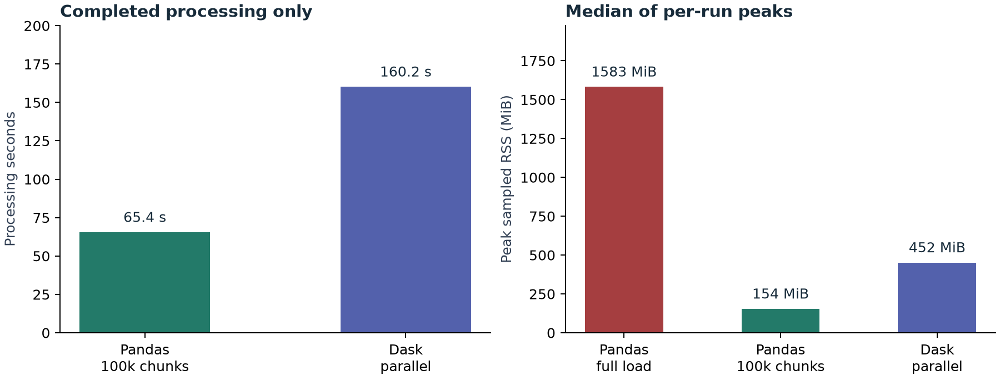
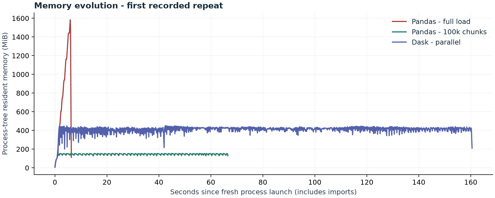
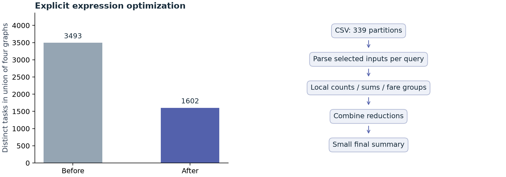

# TP02
Taxi fares beyond RAM

Big Data Analytics | University of Eloued
Second-year Master: IA & Data Science | 2026/2027

A complete CSV experiment comparing full Pandas loading, incremental Pandas processing and lazy parallel Dask computation. The report uses measurements from this project, including the actual memory failure.

## Verified input

| Property | Verified value |
| --- | --- |
| Dataset | New York City Taxi Fare Prediction |
| Training rows | 55,423,856 |
| CSV on disk | 5,697,178,298 bytes = 5.697 GB = 5.306 GiB |
| Downloaded ZIP | 1,674,619,075 bytes |
| Integrity | ZIP CRC verified; CSV SHA-256 recorded in data/manifest.json |
| Data handling | Original CSV, all rows, all eight columns. No filtering, duplication or synthetic inflation. |

## Schema and purpose

The eight fields are key, fare_amount, pickup_datetime, pickup_longitude, pickup_latitude, dropoff_longitude, dropoff_latitude and passenger_count. The two text columns use Python strings; the six numeric fields use float64 consistently across the three methods. Float64 also accommodates missing numeric values.

The experiment calculates valid counts for all columns, numeric sums and global means, plus fares grouped by passenger count. It does not train a prediction model, because model training is outside TP02.

Negative fares, unusual passenger counts and invalid-looking coordinates are retained. These are raw-data summaries; data quality affects interpretation, not the comparison between methods.

# 01 / Methods and controls

## Task 1 - full Pandas loading

analysis.eager calls pd.read_csv on the entire CSV before computing the aggregates. It uses the Python parser because two preliminary full-load trials with the C parser exited with native Windows access-violation status under the cap, without a Python traceback. The exact native cause is not established. Each strategy runs in a fresh process. A Windows Job Object imposes the same 2,048 MiB committed-memory budget on every measured worker, so the full-load attempt demonstrates a real allocation failure without exhausting the whole computer.

Observed outcome: MemoryError in 3 of 3 full-load attempts. The exact exception and traceback are retained in results/eager_*.json and results/eager_*.log. The duration is time until failure, not time to process all rows.

First exception: MemoryError: allocation failed during pd.read_csv; see the saved traceback.

## Task 2 - 100,000-row Pandas chunks

analysis.stream consumes 555 chunks, never retaining the input chunks. Each has at most 100,000 rows; the final chunk has 23,856 rows. RunningTotals keeps column counts, a compensated sum vector and a small table of passenger groups.

Global mean = accumulated sum / accumulated valid count. Averaging the means of equally weighted chunks would be incorrect when the last chunk is smaller or chunks have different missing-value counts. Kahan accumulation reduces floating-point error while retaining only small numeric vectors.

## Task 3 - lazy parallel Dask

Dask reads the CSV in 16 MiB blocks, builds reductions without materializing the complete table, and executes them with 4 threads. The graph is explicitly optimized before compute. All eight columns contribute to valid counts, so the aggregate workload includes the complete schema.

## Fair measurement and practical limits

Machine: 31.85 GiB total RAM, 10 physical / 16 logical CPU cores. The 2 GiB budget is a controlled process allocation limit, not this machine's physical memory capacity. Full Pandas may succeed if that limit is removed.

Processing time excludes startup and imports, includes parsing and aggregation, and includes graph construction for Dask. psutil samples process-tree RSS and private memory every 100 ms, including imports. A launcher may cause double counting of shared pages. Sampled peaks can miss short spikes. Completed speed comparison is between chunking and Dask, which share the C parser; full-load time is time to failure using the Python parser.

# 02 / Performance benchmark

| Method | Outcome | Median time | Median peak RSS |
| --- | --- | --- | --- |
| Pandas - full load | MemoryError | 5.42 s to failure | 1582.8 MiB |
| Pandas - 100k chunks | Completed | 65.45 s | 154.1 MiB |
| Dask - parallel | Completed | 160.20 s | 451.7 MiB |

Three repetitions per method. Each repeat rotates method order to reduce systematic ordering effects. The operating-system file cache is not flushed; these measurements describe this machine and run configuration, rather than a universal speed ranking.

| Run | Status | Seconds | Peak RSS MiB |
| --- | --- | --- | --- |
| eager #1 | memory_error | 5.39 | 1582.8 |
| eager #2 | memory_error | 5.42 | 1594.9 |
| eager #3 | memory_error | 5.73 | 1567.6 |
| stream #1 | ok | 65.64 | 154.1 |
| stream #2 | ok | 65.14 | 153.9 |
| stream #3 | ok | 65.45 | 154.1 |
| lazy #1 | ok | 159.60 | 451.1 |
| lazy #2 | ok | 160.44 | 451.7 |
| lazy #3 | ok | 160.20 | 456.0 |

In these measurements, Dask was 0.41x as fast as chunking (chunking time / Dask time). A value below 1 means chunking was faster. Dask has scheduling, graph and parsing overhead; its expected advantage must be checked experimentally.

# 03 / Memory and lazy execution

The trace ends when each first-repeat process exits. A full-load failure trace is incomplete processing; the successful chunking and Dask traces represent all 55,423,856 records. Their working memory depends on chunk/partition size, thread concurrency, parser temporaries and the accumulated group table.

## Lazy evaluation and optimization

read_csv reads a small sample to infer metadata and creates partition tasks. It does not immediately load every partition. Counts, sums and groupby create a graph of dependencies. Execution begins when dask.compute is called; the final output is small and can fit in RAM.

Recorded graph: 339 partitions; 3493 distinct tasks before optimization and 1602 after. The figure on the right is a conceptual execution diagram, not an exact plot of every task. Native expression optimization can fuse tasks and project query inputs. Counts across all eight columns still require the full schema; separate reductions may parse shared CSV inputs more than once.

All four queries are submitted together to the threaded scheduler. Tasks with identical keys can be shared. Optimizing each expression separately can limit sharing and is one possible source of overhead. The task count describes the union of the four explicitly constructed graphs, before scheduler execution.

# 04 / Results and validation

| Metric | Value |
| --- | --- |
| Processed rows | 55,423,856 |
| Fare sum (USD) | 628,786,173.74 |
| Mean fare (USD) | 11.34504560 |
| Passenger count sum | 93,410,254 |
| Mean passengers | 1.68537992 |

## Fare groups

| Passengers | Valid fares | Mean USD | Passengers | Valid fares | Mean USD |
| --- | --- | --- | --- | --- | --- |
| 0 | 195,416 | 9.015344 | 8 | 9 | 29.981111 |
| 1 | 38,337,524 | 11.216405 | 9 | 23 | 36.993043 |
| 2 | 8,175,243 | 11.838421 | 34 | 1 | 13.300000 |
| 3 | 2,432,712 | 11.540597 | 49 | 1 | 2.500000 |
| 4 | 1,178,852 | 11.766069 | 51 | 1 | 9.300000 |
| 5 | 3,929,346 | 11.208401 | 129 | 2 | 8.900000 |
| 6 | 1,174,647 | 12.126156 | 208 | 64 | 8.975000 |
| 7 | 15 | 31.788667 |  |  |  |

Validation compared 6 successful full-dataset runs: integer counts match exactly; numeric sums and means match with relative tolerance 1e-10 and absolute tolerance 1e-6. The complete parsed row count also matches the extraction manifest. All details are in results/validation.json and results/summary.json.

test_analysis.py checks a hand-calculated fixture with negative fares, missing values, passenger groups and unequal final chunks. It confirms the global sum and mean, rather than testing only agreement between implementations.

## Conclusion

Under the declared memory budget, incremental and partitioned computation can process a CSV larger than available worker memory. Pandas chunking retains one batch plus summaries; Dask schedules partition work and combines reductions. Execution speed and resident memory remain empirical measurements, not guaranteed properties.

# 05 / Reproduction and submission

## Run from the project directory

python -m venv .venv

.\.venv\Scripts\python.exe -m pip install -r requirements.txt

.\.venv\Scripts\python.exe prepare.py

.\.venv\Scripts\python.exe -m unittest test_analysis -v

.\.venv\Scripts\python.exe benchmark.py --repeats 3 --budget-mib 2048 --threads 4 --block-mib 16

.\.venv\Scripts\python.exe report.py

Download the full Kaggle competition ZIP into data/ first. Sign in and accept the competition rules on your own account. prepare.py extracts only train.csv and verifies size, header, CRC during extraction, SHA-256 and row count. Existing files are reverified. The exact installed environment is also recorded in requirements.lock.txt.

## Evidence and source files

| File / folder | Purpose |
| --- | --- |
| analysis.py | Full load, streaming accumulator, native lazy reductions |
| benchmark.py | Fresh workers, Windows budget, time and psutil profiling |
| prepare.py + data/manifest.json | Reproducible extraction and integrity evidence |
| results/ | Every run, exception, RSS trace, environment and validation |
| figures/ + report/ | Measured charts and this report |
| README.md + run.ps1 | Usage and submission instructions |

The TP asks for work to be uploaded to GitHub. Code, reports, figures and benchmark evidence can be committed. The original CSV, ZIP and environment are excluded from Git. Competition rules allow educational use but restrict redistribution of raw competition data; each reader obtains it through their own Kaggle account.

Preliminary full-load trials using the C parser exited natively with status 0xC0000005 under the allocation cap, first with Arrow strings and then with object strings. No Python traceback established the exact native cause. Diagnostics are in results/pilot_arrow/ and results/pilot_cparser/, excluded from the final comparison. Final measurements use object strings; full-load uses the Python parser and both successful methods use the C parser.

## References

- [Dataset and download](https://www.kaggle.com/competitions/new-york-city-taxi-fare-prediction/data)
- [Dataset terms](https://www.kaggle.com/competitions/new-york-city-taxi-fare-prediction/rules)
- [Pandas CSV / chunksize](https://pandas.pydata.org/docs/reference/api/pandas.read_csv.html)
- [Dask partition design](https://docs.dask.org/en/stable/dataframe-design.html)
- [Dask optimizer](https://docs.dask.org/en/stable/dataframe-optimizer.html)
- [Windows Job Objects](https://learn.microsoft.com/en-us/windows/win32/procthread/job-objects)
